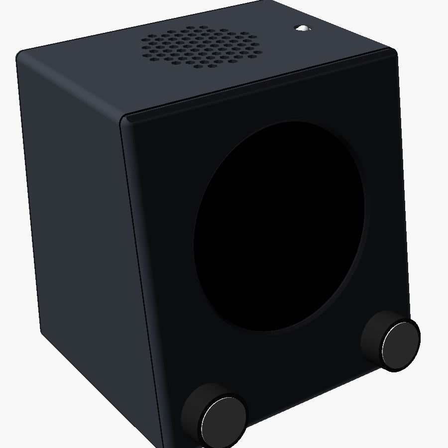
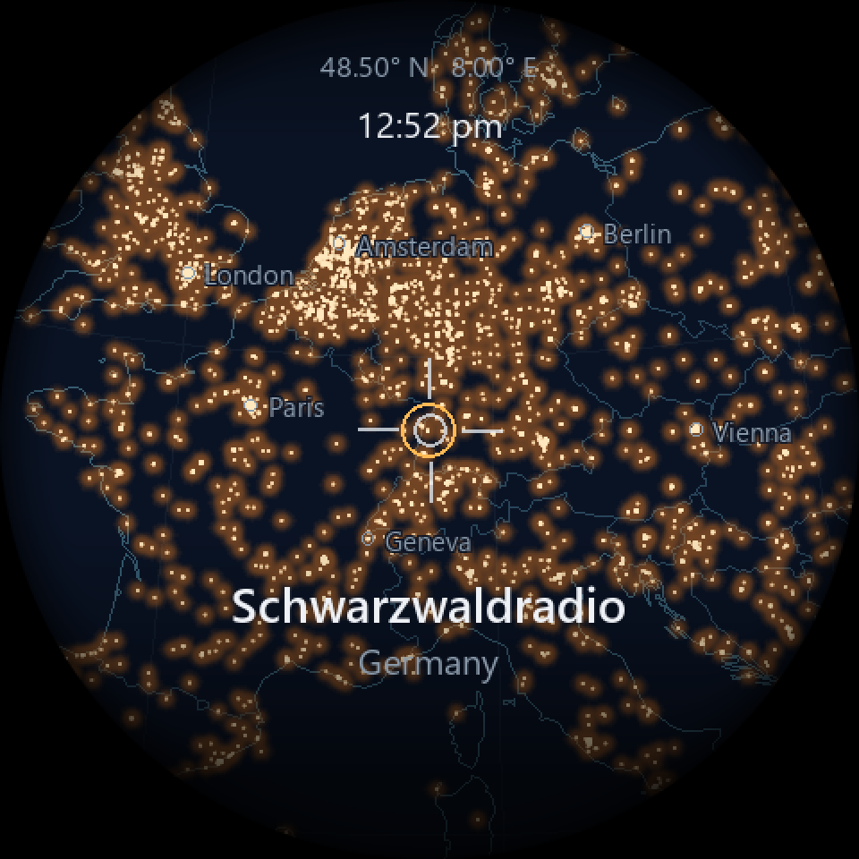
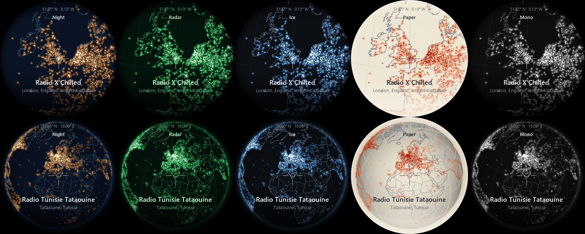
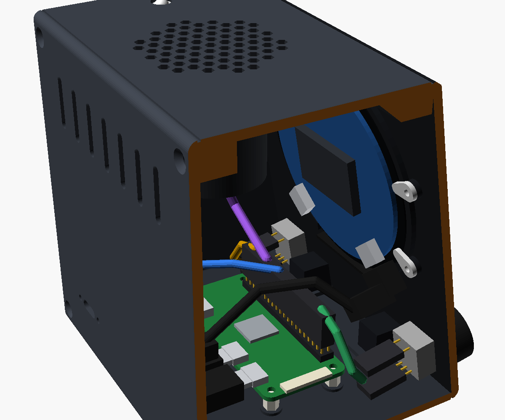

# Terradio

**Listen to live radio from anywhere in the world, on a radio that sits on your
desk.**

Terradio puts nearly 13,000 live stations from over 180 countries on a glowing
globe. Roll the trackball to spin the world to Lagos, Reykjavík, Seoul or a
small town in Chile. Stop, and the nearest station tunes in: whatever is on air
there right now, from local news and talk shows to music you'd never find at
home. It's inspired
by [Radio Garden](https://radio.garden), built as a real radio with a real dial.

<p align="center">
  
  &nbsp;&nbsp;
  
</p>

The globe is a 2.8″ round screen. Beside it are a trackball with lights under
the ball and two push knobs: **Tune** steps through the other stations around
where you stopped, and **Volume** does what it says. Sound comes from a built-in
speaker or Bluetooth headphones.

You don't need any hardware to try it. The same radio runs on a laptop, with the
mouse and keyboard standing in for the trackball and knobs.

## What it does

- **Stop anywhere and something is playing.** If a station's stream doesn't
  start within 5 seconds, it moves on to the next nearest, and stations that
  keep failing are skipped for a few days.
- **Three zoom levels** (2,000 km, 500 km, the whole world), plus "surprise me",
  which flies you to a random station somewhere on Earth.
- **On the screen:** the station's name and place, the song playing (when the
  station sends it), the local time and weather there, country borders, city
  names, and your favorite spots marked with stars.
- **Five color themes:** night, radar, ice, paper and mono.
- **A clock when idle.** After 2 minutes untouched it shows the date and a big
  clock while the globe turns slowly behind it.
- **A phone remote.** Scan a QR code on the face to open it. It has station
  search, favorites, two alarms that wake you to a station, a sleep timer, a
  world tour, brightness, and a list of songs you liked, each with a button to
  find it on Spotify.
- **Setup from your phone.** With no known Wi-Fi, the radio opens its own
  network and walks you through joining yours. Bluetooth headphones are paired
  with the knobs.
- **Updates itself** from GitHub at night. It tries the new version first and
  goes back if it won't start.
- **Game worlds** (optional). Tune around a game's map using its own radio
  stations, extracted from your own copy of the game (see
  [docs/game-worlds.md](docs/game-worlds.md)).



## Try it on your computer

You need Python 3.10 or newer and [mpv](https://mpv.io) (or `ffplay` from
FFmpeg) for the sound.

```bash
git clone https://github.com/ethanparent/terradio.git
cd terradio
python -m pip install -r requirements.txt
python radio.py --map
```

The first run downloads the station list from
[Radio Browser](https://www.radio-browser.info) and the coastlines from
[Natural Earth](https://www.naturalearthdata.com) into `data/`. Radio Browser can
be slow, so the station download may take a while. It's resumable: press
**Ctrl+C** to start with what has arrived, and run `python radio.py --update`
later to fetch the rest.

| Mouse / key | Does | On the radio |
| --- | --- | --- |
| Drag (or arrow keys) | turn the globe | roll the trackball |
| Click (or W) | zoom | press the trackball |
| Double-click (or R) | surprise me | double-press the trackball |
| Right-click (or T) | next color theme | hold the trackball |
| Mouse wheel (or [ / ]) | next / previous station nearby | turn Tune |
| F / Shift+F | next favorite / save this spot | press / hold Tune |
| + / - | volume | turn Volume |
| M / Z | mute / standby | press / hold Volume |
| H | like the song | tap both knobs |
| S | settings menu | hold both knobs |
| Q | quit | |

Add `--lan` to open the phone remote from a phone on the same Wi-Fi, then press
**P** for its QR code. [docs/laptop.md](docs/laptop.md) has every key, option
and feature.

## Build one

The radio is two boards joined by one USB cable:

- a **Raspberry Pi Zero 2 W** is the radio itself, in Python: it streams the
  stations, plays the sound, reads the trackball and knobs, and runs the phone
  page;
- an **ESP32-S3 board with a round 480×480 screen** (Waveshare
  ESP32-S3-LCD-2.8C) is the face, in Arduino C++: it draws the globe from what
  the Pi tells it.

```
 USB-C socket ──5V──► Raspberry Pi Zero 2 W   (Python: the radio)
                       ├─ Wi-Fi ◄── station streams + Radio Browser
                       ├─ mpv ─► PipeWire ─┬─► I2S ─► MAX98357A amp ─► speaker
                       │                   └─► Bluetooth ─► headphones
                       ├─ GPIO ◄── trackball + 2 push knobs
                       └─ USB (data + 5 V) ──► ESP32-S3 round face
                                                (Arduino C++: draws the globe)
```

The parts list in PLAN.md links every part. The case is 3D printed (body,
front, back and three screen clips) and held together with M2.5 screws from a
standoff kit.

| Step | Where |
| --- | --- |
| Parts list, pin map and design decisions | [PLAN.md](PLAN.md) |
| Print and assemble the case | [case/README.md](case/README.md) |
| Flash the round face | [face/README.md](face/README.md) |
| Set up the Pi as an appliance | [docs/raspberry-pi.md](docs/raspberry-pi.md) |

<p align="center">
  
</p>

## How it works

- **Stations** come from [Radio Browser](https://www.radio-browser.info), a free,
  open, community-run database. Terradio keeps the stations that passed Radio
  Browser's last check and have coordinates, and drops duplicates. The audio
  comes straight from each station's own server. You can add or correct
  stations in [`my-stations.json`](docs/laptop.md#your-own-stations).
- **The dial** (`terradio/dial.py`) turns a position into the nearest station,
  waits for the globe to settle, and falls back to the next station when a
  stream won't start.
- **The map** (`terradio/map_view.py`) is drawn with numpy and Pillow. It's the
  design reference: on the real radio the face redraws the same picture itself
  from the messages it gets, and a test checks that those messages alone
  rebuild the picture pixel for pixel.
- **The controls** (`terradio/controls.py`) don't know about mice or pins. On the
  Pi, `terradio/knobs.py` reads the trackball and knobs through gpiozero and
  makes the same calls the mouse and keys do.
- **The face** (`face/`) gets compact messages over USB serial
  (`terradio/face_link.py` is the Pi's end) and draws the globe in strips on
  both of the ESP32-S3's cores.

## Project layout

```
radio.py            start here: the radio (text dial, --map window, or --headless on the Pi)
radio_map.py        the radio's main loop
terradio/           the radio in Python: dial, player, stations, controls, phone page, ...
face/               the round face's Arduino firmware (and face/bench/, a speed test)
case/               the OpenSCAD case, STL and 3MF files, and renders
pi/                 Raspberry Pi install script, services and read-only overlay
tools/              face data packing, flashing the face over Wi-Fi, game world tools
tests/              checks for everything above
docs/               how-to pages
```

## Tests

```bash
python tests/run_all.py
```

runs every check (about 3 minutes; `--quick` takes about 30 seconds). They use
stand-ins for sound, network, pins, Bluetooth and Wi-Fi, and work on copies in a
temporary folder, so they never touch your favorites or settings.
[docs/laptop.md](docs/laptop.md#checking-that-everything-works) says what each
one covers.

## Credits

- [Radio Garden](https://radio.garden) for the idea of exploring radio on a
  globe. Terradio isn't affiliated with it and doesn't use its service.
- Station data: [Radio Browser](https://www.radio-browser.info), community-run.
  The streams belong to their stations.
- Coastlines, borders and cities: [Natural Earth](https://www.naturalearthdata.com)
  (public domain).
- Weather: [Open-Meteo](https://open-meteo.com) (CC BY 4.0).

## License

The software (everything outside `case/`) is under the [MIT License](LICENSE).
The case design in [`case/`](case/) is under
[CC BY-NC 4.0](case/LICENSE): print, change and share it freely, but not
commercially.
