# World Desk Radio case

A desk radio, 108 mm wide × 94 mm deep × 114 mm tall. The front leans back
10°, with the round 2.8″ face filling it and the Tune and Volume knobs in the
bottom corners beside it. The trackball sits on the top at the front right,
where a finger rolls it easily and pressing it pushes the radio into the desk
rather than across it. The speaker sits under a grille beside it, and the USB-C
power socket is on the back.

The outside edges are rounded (3 mm), a thin shadow line runs round each panel
where it meets the body, the screen window has a 45° bevel, and no screws show
on the front: the front panel hooks in at the top and is screwed from
underneath.

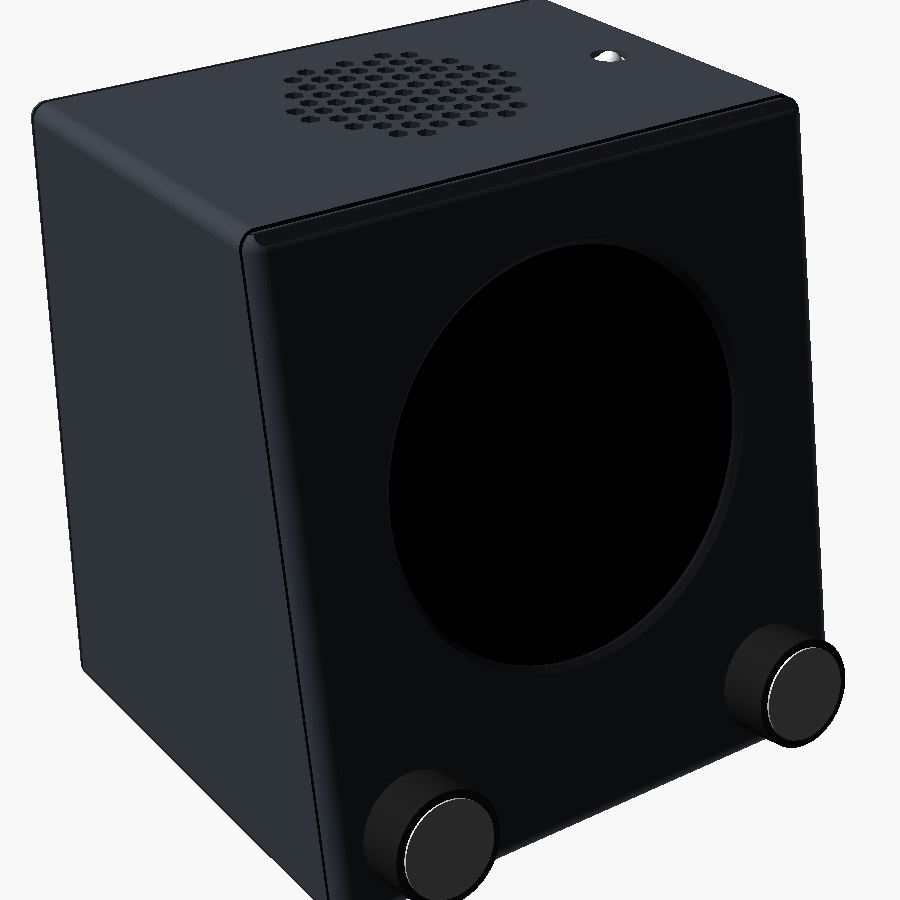

Everything is in one file, [`radio_case.scad`](radio_case.scad): a
*parametric* design. Every size is a named number at the top of the file;
change a number and the whole case follows.

## Opening it

1. Install **OpenSCAD** (free) from [openscad.org](https://openscad.org/downloads.html).
   Windows asks for administrator permission while installing.
2. Open `radio_case.scad`. Press **F5** for a quick preview.
3. In the **Customizer** panel (Window → Customizer), pick a `part` to look
   at, or change numbers without touching the code.

## The parts

| `part` | Print | Notes |
| --- | --- | --- |
| `test_holes` | first, ~20–30 min | One of each hole: knob, the USB-C socket's pocket (printed face up like the back panel, so the pocket is underneath: push the socket's plate in from below), M2.5, a nut slot like the back posts' (push a nut in from the side and screw into it from below), and an upright tab that prints the body's sideways holes just as the body will. Left to right on the tab: the trackball's hole, eight grille hexagons, a plain 3 mm round hole (to compare), the 2.2 mm pilot for the screws that cut their own thread (speaker, trackball board, face clips: try a nylon screw in it), the 2.8 mm Pi standoff hole, and the 2.8 mm hole with its counterbore for the pan head (on the back) through floor-thick plastic. Test your parts in it. |
| `test_ball` | before the body, ~15 min | The trackball's patch of the top on its own, standing up on a small foot so it prints just as the body does. Screw the trackball board onto its two bosses and check that the metal housing sits snug and flat against the thin skin, the ball and its metal lip come up through the round hole, and the ball turns and clicks freely. |
| `test_usbc` | ~5 min | The USB-C socket's patch of the back panel: a 28 × 15 mm tile, face up like the back panel, with the plate's pocket underneath. Push the plate in from below and check your power plug clicks fully home (don't glue this one). |
| `test_screws` | ~10 min, 43 × 32 mm | Every screw fixing, printed the way the case prints it, to try the kit's nylon screws and nuts. **Back post** (the square block): push a nut into its slot from the side and screw up into it through the thin square tab, the back panel's thickness. **Foot** (the tall block): push a nut into the slot in its top, then screw through the left hole of the upright tab into the foot's bottom face: the head should sit flush in the tab, as under the radio. The tab's right hole is the Pi's: check that a head sits flush there too. **Pilot holes** at 2.0, 2.1, 2.2 and 2.3 mm (the notched end is 2.0): in the flat bar, screw the clip on and check the screw bites and doesn't poke through the bottom; in the upright tab (as the speaker's and trackball's bosses print), find the size that bites firmly without being a fight. Set `m25_pilot` and `speaker_pilot` to the pilot that works best, and adjust `m25_nut_af`, `m25_nut_t` and `m25_head_h` if the nuts and heads fit loosely or tightly. |
| `test_face` | second, ~30–40 min | A ring with the screen's window, pocket and clip bosses: drop the screen in and check the fit. |
| `body` | 1 | Stands on its open back, 88 mm tall (108 × 114 mm footprint). No supports needed. Use a brim, since only the walls' edges touch the bed. Includes the trackball's hole, pocket and bosses in the top. |
| `front` | 1 | Face down, so the front takes the bed's finish (a textured PEI sheet gives an even texture). Print it in **matte black**: the screen's black border then disappears into it. Where the rounded edges meet the face they turn into a small 45° chamfer, so nothing droops on the first layers. |
| `back` | 1 | Face up, so its rounded edges print on top. The USB-C socket's plate sits in a pocket on its inside, behind a 0.8 mm skin; the skin over the pocket's ends prints as a short bridge. |
| `face_clip` | 1 set (3 clips) | Holds the screen in its pocket. Each prints flat side down with a small nub on top: the nub goes toward the screen and presses on the LCD's metal back rim, which sits lower in the pocket than the board. |

Suggested settings (OrcaSlicer): matte PLA (it hides layer lines far better
than glossy), 0.2 mm layers (0.12–0.16 mm for the front panel and body if you
have the time), 3 walls, 20% infill, no supports. Put the **seam** at the back
or "aligned" into a corner, not across the sides.

How the holes print. The body stands on its back, so holes in its top and
floor print sideways, where a round hole's top edge would sag. So:

- The **grille** holes are hexagons with a flat side toward the front (up on
  the printer): their sides hold themselves up and the flat top is a tiny
  1.75 mm bridge, so they print crisp.
- The **trackball** hole (round, for the ball and the metal lip round it) gets
  a short flat top 0.3 mm above the circle, on its front side. A flat bridges
  cleanly where a curve sags. The octagonal pocket for its housing, behind the
  skin, has a flat top too: a short bridge.
- The front panel's **feet** (printed sideways too) have teardrop-topped screw
  holes, and their nut slots stand open at the top, so nothing hangs.
- The **pilot holes** that screws cut their own thread into (speaker, trackball
  board) get a very slight teardrop: a short flat 0.3 mm above the circle, on
  their front side. Left round, the top sags and pinches the screw.
- The clearance holes the screws just pass through (Pi, the floor screws) are
  left round: a slight sag doesn't matter there.
- The screw holes in the back corner posts face straight up, so they come out
  round. The nut slot just behind each post's face has a 0.6 mm roof over it:
  a short bridge.

The test strip's upright tab prints the trackball hole, eight grille holes and
the round screw holes sideways, exactly as the body will, so you can check them
in under an hour; `test_ball` checks the trackball's whole fit. If the lip
still rubs, open the hole with an 8 mm drill bit turned by hand, or widen
`trackball_lip_d` by 0.2 mm. OrcaSlicer's "Make overhangs printable"
(in the overhang settings) is a good extra safety net for the body. The
sockets under the top have a ramp behind them so they never hang over empty
space.

To make a printable file, pick the `part`, press **F6** to render, then
**File → Export → Export as STL**.

## Hardware

| What | How many | For |
| --- | --- | --- |
Every screw is a **nylon M2.5 × 6 mm** from the standoff kit you already
have, so there's nothing to buy but a dab of glue. If your kit's nuts aren't
5 mm across their flats and 2 mm thick, change `m25_nut_af` and `m25_nut_t`.

| What (all from the standoff kit) | How many | For |
| --- | --- | --- |
| Standoffs + screws | 4 | Raspberry Pi, screwed up through the floor |
| Screws + nuts | 4 + 4 | The back panel: heads on the outside, nuts in slots in the back corner posts |
| Screws + nuts | 2 + 2 | Up through the floor into the front panel's feet (heads sunk flush), nuts in slots in the feet |
| Screws | 3 | Face clips, cutting their own thread into the clip bosses |
| Screws | 4 | The speaker's corners, cutting their own thread into the bosses under the top |
| Screws + nuts | 2 + 2 | Trackball board. They must reach no further than the preview's message says (about 4.8 mm), or they come through the top: thread a nut onto each screw first as a spacer, or snip it to 4 mm |
| Epoxy glue (Araldite, from Bunnings) | a dab | The USB-C socket's plate, in its pocket inside the back panel |

That's 19 screws and 8 nuts. Nylon threads strip easily, so tighten them all
by hand with a small screwdriver: snug, then stop.

## Measure these when the parts arrive

Calipers make this easy; a ruler works for most of it. Change the matching
number at the top of `radio_case.scad`, then reprint the test pieces.

| Number | What to measure |
| --- | --- |
| `face_lcd_t` | The screen's thickness: from its front to the back of the round LCD, where the smaller board starts (guessed at 3 mm) |
| `face_stack` | From the screen's front to the back of the tallest part on its board |
| `face_tail_w` | The width of the notch for the LCD's bottom edge, where its glass widens into a tab for the ribbon (41 mm fits the test ring) |
| `face_clip_nub` | How far below the collar's top the LCD's metal back rim sits, with the screen in its pocket (guessed at 1 mm). The clips' nubs are this tall: if a clip rocks or won't sit flat on its boss, make it smaller; if the screen still moves, larger |
| `face_clip_angles` | Where the clips press: right, top and left, where the board's flat edges leave bare metal on the LCD's back |
| `trackball_housing_h`, `trackball_ball_top` | **The two that matter most.** The heights above the board of the octagonal metal housing's flat top, and of the top of the ball. The first sets how high the board sits, so the housing presses flat against the skin |
| `trackball_lip_d`, `trackball_ball_d` | The raised metal lip round the ball (across its outside), which the round hole clears, and the ball's diameter |
| `trackball_housing`, `trackball_housing_cut` | The octagonal housing across its flats (about 9 mm), and how much its corners are cut off |
| `trackball_base`, `trackball_base_h` | The module's whole footprint round the ball, counting the black base and solder tabs that stick out past the octagon, and how tall they stand. A shallow pocket inside the top clears them |
| `trackball_board`, `trackball_ball_at`, `trackball_holes`, `trackball_pins_y` | Hold the board with its pins at the top: its size (28 × 22 mm), the ball's center from the bottom-left corner, its two mounting holes and the row of pins measured from the ball's center (all taken from a photo, so check them) |
| `trackball_skin` | How thick the case is over the housing (0.8 mm). The preview says how far the ball sticks out: aim for 0.6–1 mm, like a BlackBerry. 0.6 gives a little more ball |
| `speaker_holes`, `speaker_pilot` | The distance between the speaker's corner screw holes (side to side, not diagonal), which need to take an M2.5 screw (2.2 mm pilot) |
| `usbc_plate_t` | The USB-C socket's metal plate thickness (guessed at 1 mm; its 20.1 × 6.7 mm size comes from the listing's drawing) |
| `usbc_window_w` | The window round the socket's mouth is 13 mm wide, enough for most plugs' bodies. If yours is wider, it stops on the 0.8 mm skin, which still leaves it nearly all the way in. Make `usbc_skin` 0.6 if it won't click home |
| `m25_nut_af`, `m25_nut_t` | The kit's nuts: across their flats (guessed at 5 mm) and their thickness (2 mm). The slots are 0.2 mm wider, so the nuts push in snug and can't turn |
| `encoder_tab_offset` | Only if you turn on `encoder_tab`: the encoder's small anti-rotation tab, from the shaft center |

## Putting it together

1. Push a nut into the slot in each back corner post (from the side facing
   the middle of the case) and into the slot in each of the front panel's two
   feet (from the foot's back end), until each stops.
2. Mount the Pi on its standoffs, screwed up through the floor.
3. Plug the angled USB-C cable into the board's socket marked UART (lower
   left, seen from the front), turned so the cable heads back into the case.
   Drop the screen into its pocket (screen facing out, ribbon at the bottom)
   and screw on the three clips, nub down onto the LCD's metal rim. Snug, not tight: they press on
   the back rim of the LCD, just outside the smaller board behind it.
4. Fit the knobs' encoders through their holes (nut on the front). Before the
   trackball board goes in, solder its header on the bench with the pins
   pointing down, and snip the short ends on top short: a groove inside the
   top clears them, but only by about 1 mm. Don't solder it in place, because
   the skin round the ball's hole is thin and the iron would melt it. Then
   screw the board onto its two bosses under the top so the ball pokes up
   through its hole, pins toward the middle of the case. It sits a quarter
   turn round from how it would sit on the front, so swap its direction pins
   in the code until the globe follows your finger.
5. Screw the speaker (AUIN 2″, 53 mm square frame) to the four bosses under
   the top grille, cone facing up.
6. Fit the front panel: hold it level and slide it **straight back** (not
   along its slope) until its two tongues go into the sockets under the top
   and its feet sit on the pads on the floor. Then, from underneath, put a
   screw up through each of the two holes in the floor into the feet's nuts. The
   screws also stop the panel tipping forward.
7. Push the USB-C socket's plate into its pocket inside the back panel, mouth
   outward, and check a plug goes fully home. Then glue it in with epoxy round
   the plate's edges on the inside (keep it off the socket's mouth), and leave
   it to set. Then screw on the back panel.

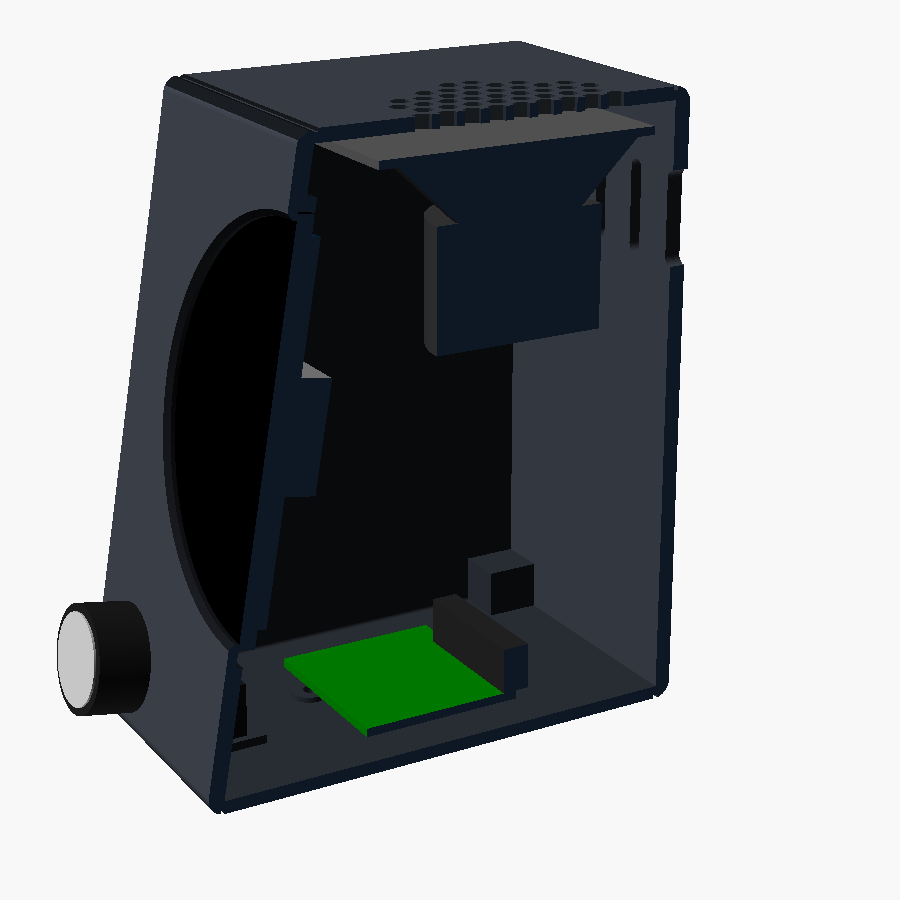

### The hidden fixing

The back of the front panel (left): two tongues near the top, two feet at the
bottom. Inside the body (right): the tongues' sockets under the top, and the
feet's pads on the floor with the screw holes through them.

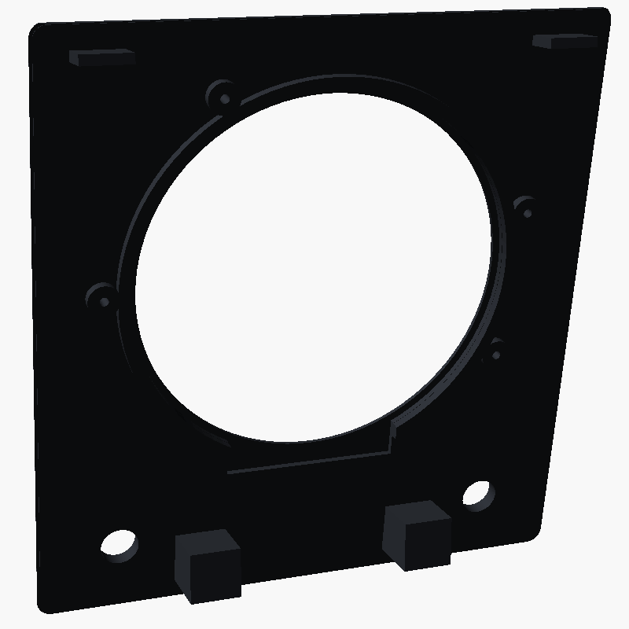
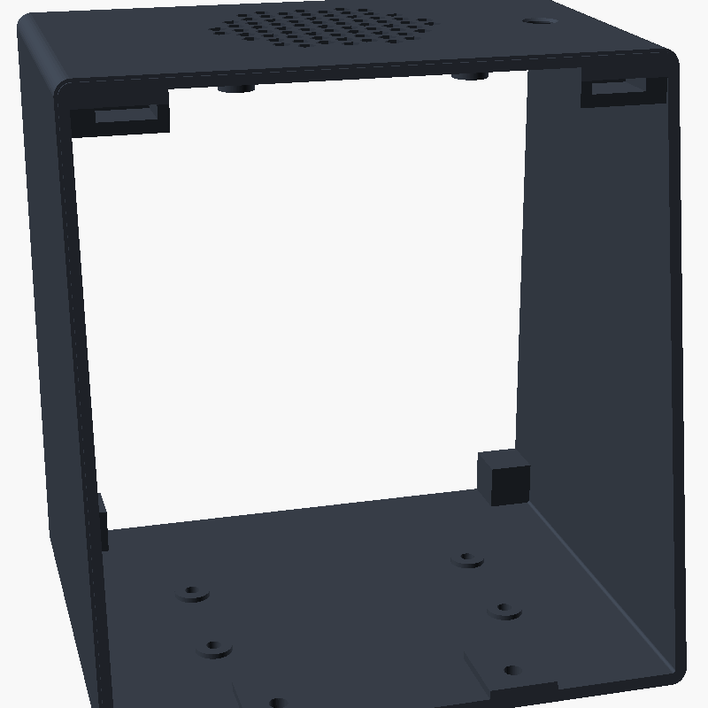

The look is set by three numbers in the Shape section: `edge_r` (the rounded
edges), `reveal` (the shadow line's width) and `window_bevel` (the screen
window's bevel).

The screen in the front panel, seen from behind: the round LCD (black) sits in
a low collar, its smaller board (green) sits behind it, and the three clips
press on the LCD's rim.

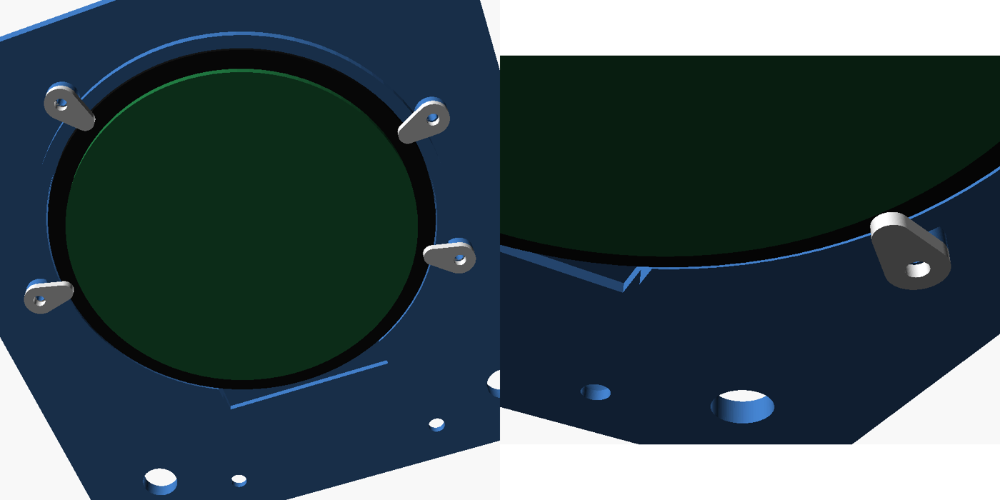

## The whole build

[`build_preview.scad`](build_preview.scad) loads the case and adds every
part and cable at its real size and place: the Pi on its standoffs, the
screen and its clips, both knobs with their encoders, the trackball module,
the speaker, the amp, the power socket, the power cable, the screen's angled
USB cable, and the jumper wires (in the wiring sheet's colors). Set `show` to
pick what to draw: `"all"`, `"inside"` (left side cut away), `"open_back"`
(back panel off), `"parts"`, or one group. Nothing in it is printed.

Checked with it: no part or cable touches the case, and the only places parts
meet are where they plug into each other. Two things moved to get there: the
Pi sits 10 mm further back than before, so the screen's angled USB plug
(which turns back into the case at the screen's lower left) clears the
jumper plugs on the Pi's pin header; and the amp sits just behind the Pi.
The Pi is turned so its pin header runs along the front edge (short wires to
the knobs and the trackball) and its two USB ports face the back.

Two things to know when you build it:

- **The amp has no mount yet.** It sits on its jumper plugs behind the Pi.
  Stick it down with a pad of double-sided foam tape, or ask for a small
  holder in the floor.
- The screen cable's angled plug sits level with the back rim of the screen's
  glass, so the two may just touch. Check with the real cable when it arrives.

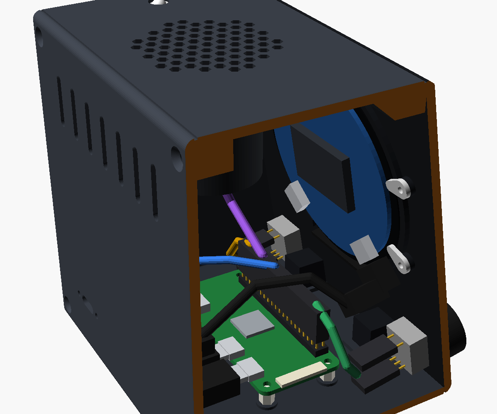
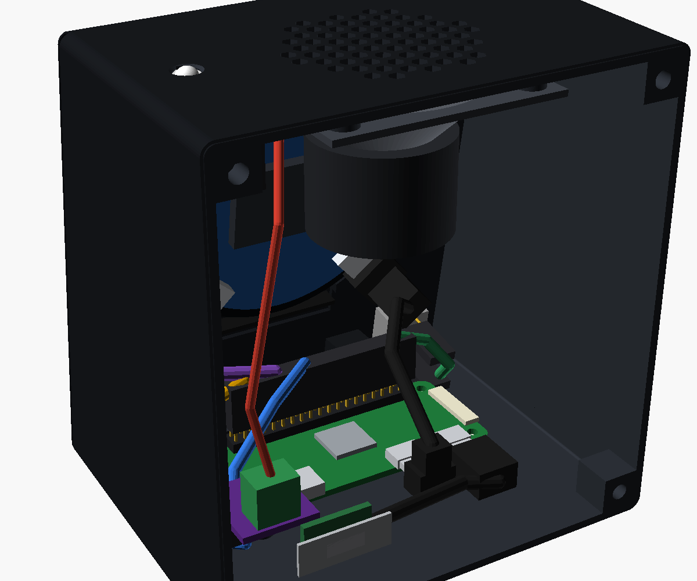
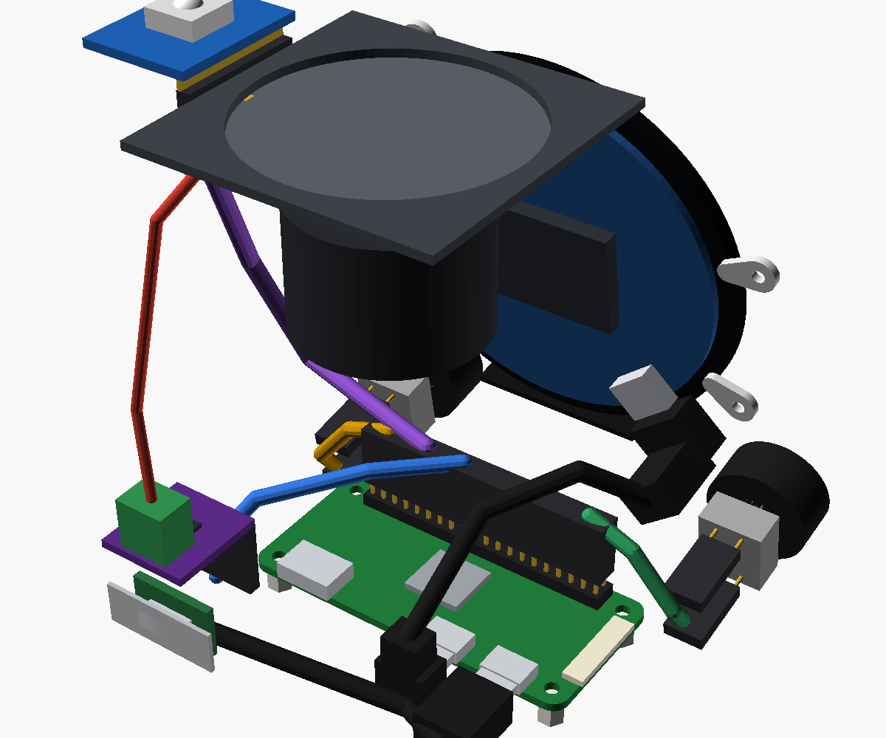

## The trackball: on top or on the front

`ball_on_top = true` (the default) puts the ball on the top, beside the grille.
Set it to `false` for the earlier layout with the ball on the front between the
knobs; that needs the front panel longer to fit the ball's board under the
screen, so also set `front_len = 133`, `controls_v = 16`, `tilt = 20` and
`depth = 118` (108 × 118 × 125 mm). For left-handed use, change `ball_top` so
the ball sits at the left instead.

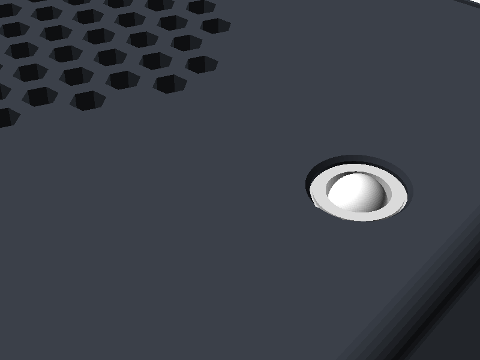
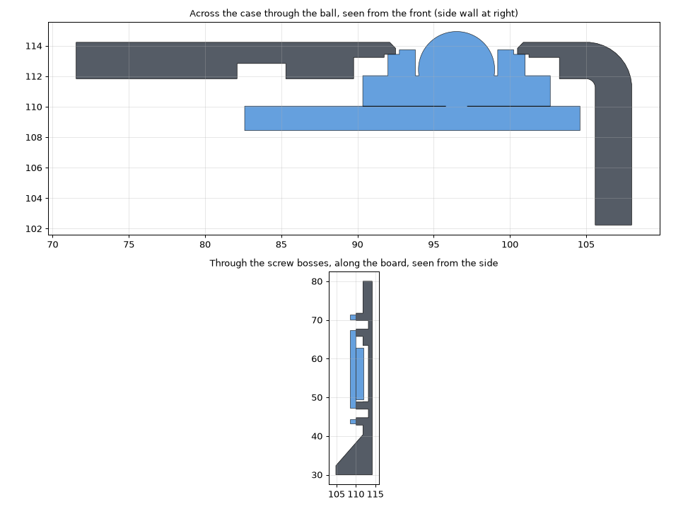
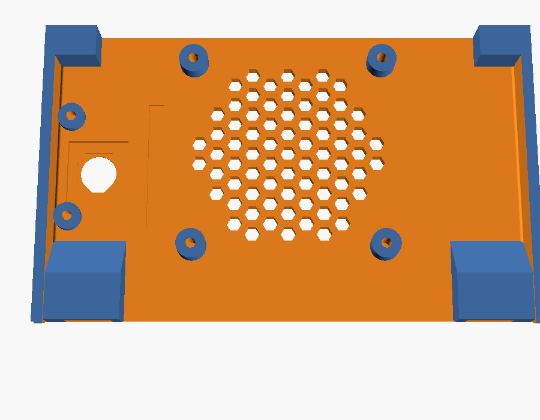

## License

The case design (everything in this folder) is under
[CC BY-NC 4.0](LICENSE): print it, change it and share it, with credit, but not
commercially. The rest of World Desk Radio is under the MIT License.
